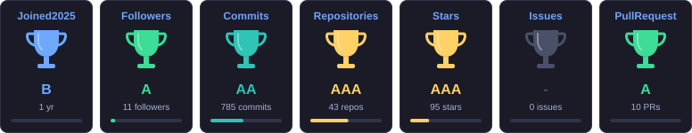
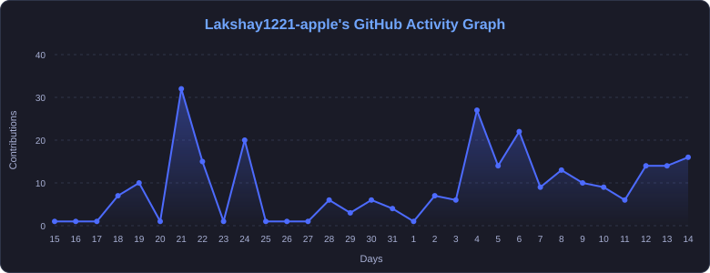

<!-- ═══════════ HEADER BANNER ═══════════ -->

  

<!-- ═══════════ MARIO GIF ═══════════ -->

  

<!-- ═══════════ CONTACT BADGES ═══════════
     TODO: replace the placeholder handles below with your real profile links,
     then remove the comment markers around each badge. -->

  
  
  <!--  -->
  <!--  -->
  <!--  -->

<!-- ═══════════ TYPING HEADINGS (emoji + apostrophe are URL-encoded) ═══════════ -->

  

  

<!-- ═══════════ PROFILE VIEWS ═══════════ -->

  

⚙️ Skills & Tools

📊 GitHub Stats
<!-- Trophies + activity graph are generated from PUBLIC GitHub profile data only
     by .github/workflows/profile-assets.yml. Private repositories and private contributions
     are excluded from all generated statistics. -->

<b>🏆 Trophies</b>

 

<b>🔥 Streak & Summary</b>

 

 

<b>📈 Activity Graph</b>

 

🐍 Snake Eating My Contributions

<picture>
  <source media="(prefers-color-scheme: dark)" srcset="https://raw.githubusercontent.com/Lakshay1221-apple/Lakshay1221-apple/output/github-snake-dark.svg" />
  <source media="(prefers-color-scheme: light)" srcset="https://raw.githubusercontent.com/Lakshay1221-apple/Lakshay1221-apple/output/github-snake.svg" />
  
</picture>

🙋 About Me
👨‍💻 Lakshay Raj
- 💼 Full Stack Developer (in progress)
- 🤖 AI/ML Explorer
- 📧 Email: lakshaywork012@gmail.com
- 🚀 Building real-world impactful projects
- 🔥 Always learning & leveling up
 

  

